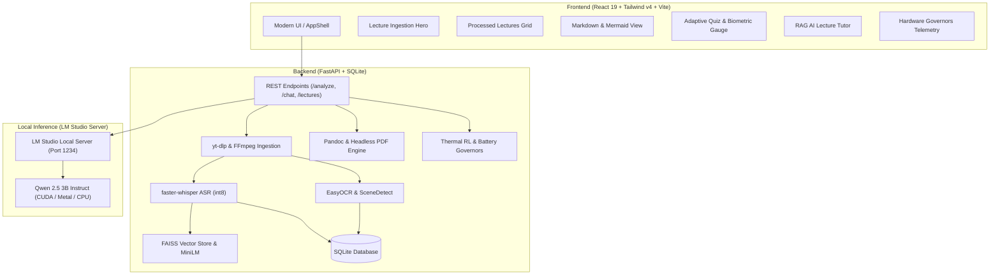

# AI Lecture Video Analyzer & Smart Edge Study Suite

> **An on-device, privacy-preserving AI pipeline that transforms long lecture recordings into structured Markdown study notes, Mermaid.js process diagrams, adaptive practice quizzes, and interactive RAG chat tutors — powered by local LLMs with zero API costs.**

---

## Overview

**AI Lecture Video Analyzer** is a multi-modal edge application designed to process video and audio lectures locally on commodity consumer hardware. By combining **FastAPI**, **faster-whisper**, **EasyOCR**, **FAISS vector search**, and local LLMs via **LM Studio**, the system delivers an end-to-end learning suite while keeping all student data and lecture media strictly on your machine.

In addition to core study material synthesis, the suite incorporates **Edge Hardware Governors** that adapt computational workloads based on real-time ACPI thermal zone sensors, battery discharge levels, and biometric student stress metrics.

---

## Key Features

- **Automated Video & Audio Ingestion**: Downloads YouTube lectures or processes local video files via `yt-dlp` and extracts 16kHz mono WAV audio with `ffmpeg`.
- **Fast Local Speech-to-Text**: High-throughput transcription powered by `faster-whisper` (int8 quantization with multi-threaded CPU execution).
- **Computer Vision Slide Extraction**: Automatically detects scene transitions using `PySceneDetect` and extracts text from lecture slides and blackboards with `EasyOCR`.
- **Structured Markdown Notes**: Formats lecture transcriptions and slide visual text into organized study notes with clear headings, bullet points, and markdown tables.
- **Process Flowchart Generation**: Extracts sequential workflows, algorithms, and system architectures from lecture transcripts into interactive **Mermaid.js** diagrams.
- **Adaptive Practice Quizzes**: Generates 5–10 question MCQ quizzes tailored to beginner, intermediate, or advanced cognitive loads.
- **Interactive RAG Tutor Chat**: Ask questions grounded in lecture content using a local `FAISS` vector index and `sentence-transformers` embeddings (`all-MiniLM-L6-v2`).
- **High-Fidelity PDF Export**: Exports lecture notes into styled, publication-ready PDFs via `Pandoc` and headless browser rendering.

---

## Edge Hardware Extensions

### 1. ACPI Thermal RL Governor (Option #2)
- Continuously polls physical ACPI thermal sensors (`\_tz.core_acpi`, `\_tz.die_est`) and CPU load via `psutil`.
- Implements a **Reinforcement Learning (Q-learning) Agent** that observes physical silicon temperatures and dynamically shifts between a full-precision model (`qwen2.5-3b-instruct`) during safe temperatures (<60°C) and compact quantized model tiers during elevated thermal throttling (>=75°C).
- Features interactive simulation controls:
  - **Simulate Thermal Throttling Spike**: Instantly injects an 82.5°C critical spike to demonstrate the RL agent's dynamic fallback policy.
  - **Run Real Hardware Stress Test**: Generates genuine multi-threaded matrix multiplication operations on CPU cores to physically heat up silicon hardware.

### 2. Battery Discharge & Dynamic Silicon Core Affinity Governor (Option #8)
- Monitors battery capacity, charging status, and remaining runtime.
- **Dynamic Core Affinity**: Dynamically binds compute-heavy Whisper/OCR workloads to high-efficiency or performance silicon cores.
- **Predictive Power-Gating**: Evaluates energy requirements before execution; under critical battery levels (<20%), automatically suppresses heavy visual OCR tasks to guarantee quiz generation and PDF export before battery shutdown.

### 3. Display Output Frame Buffer Grabber (Option #5)
- Emulates hardware-level smart-board capture cards and display buffer feeds.
- Computes perceptual frame hashes (pHash) and SSIM metrics to detect slide advances in real-time, eliminating redundant frames while streaming captured keyframes into an interactive lightbox inspector.

### 4. Biometric Cognitive Load Adaptive Quiz Engine (Option #3)
- Measures heart rate live from the laptop webcam via remote photoplethysmography (rPPG); GSR skin conductance and EEG $\alpha/\beta/\theta$ ratios come from the built-in sensor emulator (standard laptops carry no such sensors).
- Dynamically adapts quiz difficulty (Beginner Recall vs. Analytical Reasoning) based on the student's live cognitive load.
- Camera frames are processed in memory only (face-region colour averages) and never stored; the reader can be switched off from the quiz view or via `POST /system/biometrics/camera`.

---

## System Architecture



---

## Project Structure

```text
ai-proj/
├── backend/
│   ├── models/
│   │   ├── __init__.py
│   │   └── models.py                 # SQLite ORM models (Lectures, Notes, Quizzes, ChatLogs)
│   ├── services/
│   │   ├── __init__.py
│   │   ├── auth.py                   # Authentication utilities
│   │   ├── biometric_adaptive.py     # Biometric EEG/PPG/GSR cognitive load engine
│   │   ├── charts.py                 # Matplotlib trend generation
│   │   ├── cleaner.py                # Markdown unwrapping & Mermaid sanitization
│   │   ├── export.py                 # Pandoc + Headless browser PDF generator
│   │   ├── frame_buffer_grabber.py   # Display frame buffer capture & deduplication
│   │   ├── ingestion.py              # yt-dlp download & ffmpeg audio extraction
│   │   ├── llm.py                    # LM Studio client & prompt orchestration
│   │   ├── ocr.py                    # PySceneDetect & EasyOCR slide text extraction
│   │   ├── power_governor.py         # Battery discharge & silicon core affinity governor
│   │   ├── rag.py                    # FAISS vector store & transcript retrieval
│   │   ├── thermal_agent.py          # ACPI Hardware sensor & Q-learning thermal governor
│   │   ├── transcription.py          # faster-whisper local ASR worker
│   │   └── webcam_ppg.py             # Live webcam rPPG heart-rate reader (YuNet face lock)
│   ├── database.py                   # SQLAlchemy connection & session manager
│   ├── main.py                       # FastAPI application & background task router
│   └── .env.example
├── frontend/
│   ├── src/
│   │   ├── api/
│   │   │   └── client.js             # Centralized Axios client
│   │   ├── components/
│   │   │   ├── layout/               # AppShell, PageHeader, SectionHeader
│   │   │   ├── lectures/             # VideoSubmitForm, LectureCard, LectureList
│   │   │   ├── telemetry/            # ThermalGovernor, PowerGovernor, FrameGrabber
│   │   │   ├── ui/                   # Button, Badge, Card, Modal, MetricChip, etc.
│   │   │   ├── ChatWidget.jsx        # AI Lecture Tutor chat with auto-scroll
│   │   │   └── MarkdownRenderer.jsx  # react-markdown + remark-gfm + charts
│   │   ├── context/
│   │   │   └── ToastContext.jsx      # Non-blocking notification stack
│   │   ├── hooks/
│   │   │   ├── useTelemetry.js       # Unified 1.5s hardware telemetry polling hook
│   │   │   └── useToast.js
│   │   ├── pages/
│   │   │   ├── Dashboard.jsx         # Modular main dashboard
│   │   │   ├── LectureView.jsx       # Notes, diagrams & AI chat
│   │   │   └── QuizView.jsx          # Biometric gauge & practice quiz
│   │   ├── App.jsx
│   │   ├── index.css                 # Tailwind v4 theme tokens & scrollbars
│   │   └── main.jsx
│   ├── package.json
│   ├── tailwind.config.js
│   └── vite.config.js
├── .gitignore
└── README.md
```

---

## Installation & Setup

### Prerequisites

1. **Python 3.11+** installed.
2. **Node.js 18+** & `npm` installed.
3. **FFmpeg** installed and accessible on your system PATH (`ffmpeg -version`).
4. **Pandoc** installed on your system PATH (`pandoc --version`).
5. **LM Studio** installed ([lmstudio.ai](https://lmstudio.ai/)).

---

### Step 1: Start LM Studio Local LLM Server

1. Open **LM Studio**.
2. Search and download **`qwen2.5-3b-instruct`** (or your preferred local model).
3. Navigate to the **Developer / Local Server** tab (`<->` on the left sidebar).
4. Select `qwen2.5-3b-instruct` in the top model dropdown.
5. Toggle **Start Server** on port `1234` (enable CORS).

*Alternatively, start it via CLI:*
```powershell
lms server start --cors --port 1234
lms load qwen2.5-3b-instruct
```

---

### Step 2: Setup and Run Backend

```powershell
# Navigate to backend directory
cd backend

# Create and activate virtual environment
python -m venv venv
.\venv\Scripts\activate   # On Windows
# source venv/bin/activate  # On Linux / macOS

# Install dependencies
pip install fastapi uvicorn sqlalchemy pydantic yt-dlp ffmpeg-python faster-whisper opencv-python easyocr scenedetect sentence-transformers faiss-cpu openai psutil numpy

# Start FastAPI server
$env:PYTHONIOENCODING="utf-8"
python -m uvicorn main:app --reload --port 8000
```

- API Swagger Documentation: [http://localhost:8000/docs](http://localhost:8000/docs)
- Health Check: [http://localhost:8000/health](http://localhost:8000/health)

---

### Step 3: Setup and Run Frontend

In a separate terminal:

```powershell
# Navigate to frontend directory
cd frontend

# Install Node modules
npm install

# Start Vite dev server
npm run dev
```

Open your browser at **[http://localhost:5173](http://localhost:5173)**.

---

## API Endpoints Reference

| Method | Endpoint | Description |
|---|---|---|
| `GET` | `/health` | Server connectivity check |
| `POST` | `/analyze` | Submit a lecture URL for async background processing |
| `GET` | `/lectures` | Retrieve list of all processed lectures |
| `GET` | `/lectures/{id}/notes` | Get generated study notes & Mermaid diagram |
| `GET` | `/lectures/{id}/quiz` | Get generated adaptive multiple-choice quiz |
| `POST` | `/chat` | Query RAG tutor with lecture context |
| `GET` | `/lectures/{id}/export` | Download high-fidelity PDF of lecture notes |
| `GET` | `/system/thermal` | Live ACPI temperature, CPU load, and RL model tier |
| `POST` | `/system/thermal/simulate-spike` | Toggle simulated 82.5°C thermal spike |
| `POST` | `/system/thermal/physical-stress` | Toggle genuine multi-threaded CPU matrix burn |
| `GET` | `/system/power` | Live battery capacity, runtime estimate, and affinity mask |
| `POST` | `/system/power/simulate-discharge` | Toggle simulated critical 14% battery state |
| `GET` | `/system/framebuffer` | Smart-board frame grabber stream metrics & snapshots |
| `GET` | `/system/biometrics` | Student stress telemetry (heart rate live via webcam rPPG; GSR/EEG emulated) |
| `POST` | `/system/biometrics/camera` | Enable/disable the in-memory webcam rPPG reader |

---

## License

This project is licensed under the **MIT License**.
